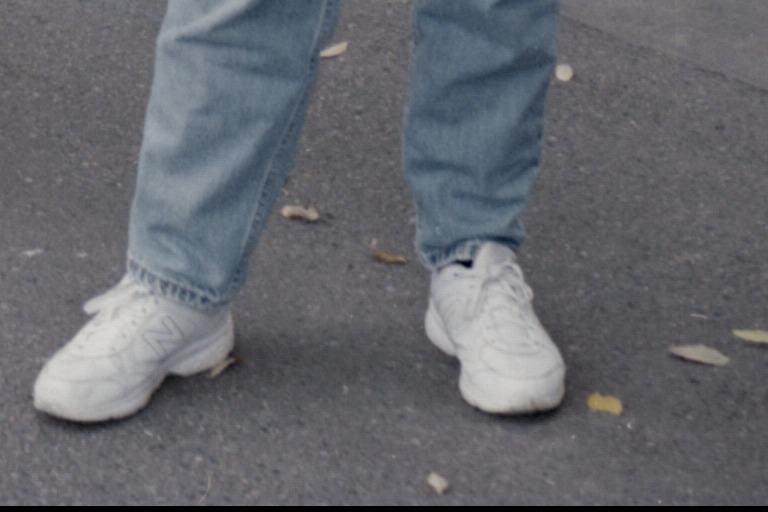

# Notes

## 2026-11-06

- Identified the device: Plustek SmartPhoto F50, USB `07b3:0b00`.
- Vendor-specific interface, bulk IN + interrupt IN, no bulk OUT. Commands must
  be control transfers.
- No SANE backend, no kernel driver.
- Windows driver package is `F50V4111WebDriver.rar` (v4.1.1.1, 2009-11-05,
  28.4 MB). Plustek's download page is JS only; DriverGuide mirrors it behind a
  checkbox gate.

### Driver teardown

- `F50V4111WebDriver.rar` -> InstallShield -> `unshield x data1.cab` -> `DRV_U_GT6816/`:
  `FWofWin.bin` (7955 B), `Scandrv.dll` (scan engine, uses Jungo WinDriver
  `WDAPI1010.dll`), `Reg.ini`, `module.ini`, `Positive.map` (3 x 4096 x 16-bit
  tone LUT, so the AFE path is 12-bit).
- `Reg.ini`: `ID_0000=VID_07B3&PID_0B00`, `;Firmware=CISM216.fw`,
  `DeviceCaps=600,600,1800,1800,150,150`, `SupportDpiX/Y=1,1800`,
  `ExposureTime=600`, `Gain=120`, `RGBGamma=180,120,100`, `FWVersion=0.6.1.8`.
  "CISM" says the sensor is a CIS line sensor (a CMOS linear array with its own
  LED light), which is what the manual's "Image Capture CMOS" means. There is
  no Bayer mosaic to undo: R, G and B are separate exposures of the same line.
- The manual says the film holder is pushed through by hand and indexes per
  frame with notches, so the only motor inside moves the sensor across one frame.
- *(Corrected 2026-11-07: the F50's USB controller is an FX2-compatible USB
  microcontroller, exact part unknown, not a GT-6816; see "Correction: the USB
  controller" below. The GT-6816 statements in this section are history.)*
- The GT-6816 is Grandtech's 8051-based scanner controller. SANE's `gt68xx`
  backend drives it for many Mustek/Plustek/Genius flatbeds, with 8/12/16-bit
  linear output, software gamma that can be set to 1.0, and calibration that
  can be switched off. That is the most direct route to "raw sensor data".
- `tools/fwinfo.py`: `FWofWin.bin` is a Cypress-style C2 image: 8-byte header
  (VID/PID/DID/config) then (length, address, data) records; the 8051 code
  covers 0x0000-0x1f38 and the final record writes 0x00 to 0xE600 (CPUCS,
  "run"). The firmware uses the EZ-USB FX2 register map (CPUCS, IFCONFIG,
  EP2CFG, SETUPDAT at 0xE6B8, EP0BUF at 0xE740) and embeds the USB descriptors
  we see from `lsusb` (strings "Film Scanner").
- `tools/fx2probe.py`: the device does NOT answer the FX2 ROM loader request
  0xA0 (every address returns the same junk), so this is not a stock Cypress
  part. (Later corrected: with firmware running and RENUM set, an FX2 passes 0xA0 to the
  firmware, which stalls or returns junk, so this does not rule out an FX2.)
- SANE's `gt6816_download_firmware` sends the file raw, 64 bytes at a time, to
  address 0 via vendor request 0x01 / wValue 0x200b, then "boot" (0x69 0x01).
  Whether it needs a flat image or accepts the C2 wrapper is still open; the
  device already runs firmware from its own EEPROM (strings are present
  before any driver touches it), so the backend may not need to load anything.

### Next

1. Decode the firmware's EP0 vendor-request dispatcher (`r2 -a 8051`) and
   `Scandrv.dll`'s WinDriver control transfers (Ghidra) to confirm the request
   numbers match gt68xx's `mustek_gt6816_command_set`.
2. If they match: add a `plustek_smartphoto_f50_model` to `gt68xx_devices.c`
   (1800 dpi CIS, small scan area), build, test with the firmware already
   resident, then tune geometry, AFE gain/offset and exposure.
3. Raw output = 16-bit mode, `--gamma-value 1.0`, calibration off.

### USB protocol (from the firmware's EP0 handler, `FWofWin.bin` 0x0df0)

The firmware's standard-request switch handles GET_STATUS, CLEAR/SET_FEATURE,
GET_DESCRIPTOR, GET/SET_CONFIGURATION, GET/SET_INTERFACE. Its vendor handler
accepts exactly one bRequest, 0x04, in two forms; anything else stalls:

| Direction | bmRequestType | bRequest | wValue | wIndex | wLength | Meaning |
|---|---|---|---|---|---|---|
| OUT | 0x40 | 0x04 | 0x0011 | 0x0001 | 64 | command block, copied to XDATA 0x2800 |
| IN | 0xC0 | 0x04 | 0x0010 | 0x0000 | 64 | runs the command interpreter, returns the 64-byte reply from XDATA 0x2800 |

Image data arrives on bulk EP2 IN (512-byte packets). EP1 IN is a 1-byte
interrupt endpoint (likely the scan button).

The command interpreter (code 0x0166) switches on the first two bytes of the
block as a 16-bit little-endian opcode. Opcodes 0x00 to 0x19 exist (0x18 is
missing, 0x10 to 0x12 share one handler); handler addresses in the flat image:

```
00:0202 01:023e 02:026d 03:0272 04:0277 05:027c 06:02b3 07:02b8 08:0300 09:0305
0a:06c1 0b:0474 0c:0505 0d:0288 0e:0413 0f:0429 10/11/12:07b7 13:059a 14:05fc
15:065e 16:06f6 17:0758 19:0781 default:07b5
```

So this is Plustek's own mailbox protocol, not the gt68xx command set, even
though the chip family is the same. SANE's gt68xx backend cannot be reused
as is; its memory-write/boot requests would just stall. The device already
runs this firmware from its own EEPROM, so no download step is needed.

Host side: `Scandrv.dll` talks to the device through Microsoft's `usbscan.sys`
(`CreateFileA` + `DeviceIoControl`, interface enumerated with SetupDi) and
uses Jungo WinDriver only for streaming bulk reads (`WDU_StreamRead`).

### Host software architecture (Windows)

- `WDUScan.exe` is an out-of-process COM server ("WDUFilmScanner Class",
  CLSID `{81C5FF24-3C8B-494D-A29C-181923112BCB}`, events
  `_IWDUFilmScannerEvents`) built on Jungo WinDriver (licence string
  `WD_Ver1010_Plustek`). It exposes `DoUsbControlIn`, `DoUsbControlOut`,
  `GetEventValue` and raises the interrupt-endpoint event.
- `Scandrv.dll` (export `ScannerCommander`) is the engine: it builds the
  64-byte command blocks, sends them through the COM server, and pulls image
  data itself with `WDU_StreamRead` on pipe 0x82. Its `\\.\HCD%d` and
  SetupDi code is only the "is this a USB 2.0 port" check.
- `TWAIN_32.ds` and the WIA microdriver (`MidrvA41.dll`, `WIAA4103.dll`) sit
  on top of `ScannerCommander`.

So every register write the scanner ever sees originates in `Scandrv.dll`.
Recovering the init, lamp, calibration and scan-setup sequences from it is
the remaining reverse-engineering job (delegated to the RE workbench).

### Live results (2026-11-06, `tools/f50.py`)

The mailbox protocol works from Linux with pyusb. Replies carry `0x1234` at
bytes 2..3 on success (`0x5678` on error, from the firmware's interpreter).

| Opcode | Reply | Meaning |
|---|---|---|
| 0x00 | `00 06 01 08` | firmware 0.6.1.8 (matches `Reg.ini` FWVersion) |
| 0x01 | `01 02 04` | protocol 1.2.4 |
| 0x0f | `02 02 82 03 81` | bulk EP 0x82, interrupt EP 0x81 |
| 0x19 get | 3 | mode variable (firmware compares it with 0x0b elsewhere) |
| 0x0a get | 0 | second mode variable |

### What the register opcodes really are

The firmware's register helpers write XDATA 0xE678/0xE679, which in the FX2
register map are I2CS/I2DAT: the "registers" are an I2C slave at 7-bit address
0x30. Opcode 0x0b = I2C write of (reg, value) pairs; 0x0c = write reg, read one
byte. Opcodes 0x13/0x14 are generic I2C reads/writes to any address, and
0x15/0x16 read/write 32-byte pages with a 16-bit address: the boot EEPROM.
**Never send 0x16** (or 0x14 at the EEPROM address); `tools/f50.py` blocks
them. At boot the firmware sets IFCONFIG=0xC3 (internal 48 MHz clock, slave
FIFO mode), so the pixel stream is pushed into EP2's FIFO by the engine
hardware; the host only configures the engine over I2C and reads bulk 0x82.

### The engine is an image sensor: OmniVision OV5620

Reading the I2C 0x30 device's registers (`docs/engine-regs-poweron.txt`):
`0x0a/0x0b = 0x56 0x21` (PIDH/PIDL) and `0x1c/0x1d = 0x7f 0xa2` (MIDH/MIDL,
OmniVision's manufacturer ID). That is the OV5620, a 1/2.5" 5-megapixel
(2592 x 1944) Bayer CMOS sensor, SCCB write address 0x60 = 7-bit 0x30.
Everything fits: the manual's "Image Capture CMOS", the "5 MP" marketing,
1800 dpi (2592 px across a 36.6 mm frame), no motor, 100 mA bus power, the
hand-indexed holder, and `Reg.ini`'s ExposureTime/Gain/RGBGamma, which are
sensor exposure, sensor gain and per-channel white balance.

So the F50 is a fixed camera with a backlight. The USB controller only pipes the
sensor's parallel pixel bus into the USB FIFO (slave FIFO mode) and relays
I2C. "Raw sensor data" therefore means: configure the OV5620 for its raw
Bayer output, manual exposure, gain 1x, no AWB/gamma, grab full frames over
bulk 0x82, demosaic on the PC. The Windows `Positive.map`/`Negative.map`
12-bit LUTs are what the DLL applied afterwards and can be skipped.

Registers 0x04 to 0x09 change between reads (live AEC/AGC state).

## 2026-11-06 (later): Windows capture sequence, first frames on Linux

Labels: **proven** = observed on the device or read directly in code;
**inferred** = deduced, not yet tested.

### Who programs the sensor (proven, from the decompiles)

`Scandrv.dll` only builds mailbox commands for the firmware's own opcodes (1, 2, 5, 7,
8, 9, 0x0a) and calls the COM server. The sensor setup and the bulk read both live in
`WDUScan.exe` (decompiled with Ghidra headless into the private RE folder). COM vtable
of the `WDUFilmScanner` object (offsets after IDispatch):

| vtable | WDUScan function | Role |
|---|---|---|
| 0x2c | FUN_004032c0 -> FUN_00402930 | sensor setup (exposure, gain, WB, mode) |
| 0x30 | FUN_004043b0 -> FUN_00404150 | capture N bytes from bulk 0x82 |
| 0x34 | FUN_00403360 | interrupt EP 0x81 event value |
| 0x38/0x3c | | raw control OUT/IN (Scandrv FUN_1000bb60/bc30) |
| 0x28 | FUN_00403150 | sends opcode 0x16 (EEPROM page write). Never used by us. |

Scandrv's scan path (FUN_100053b0) calls 0x2c with `(1, ExposureTime=600,
Gain*0.01=1.20, 1, RGBGamma*0.01 = 1.80, 1.20, 1.00)`, then 0x30 with 0x4ce300 bytes,
then demosaics the buffer as **0xa20 x 0x798 = 2592 x 1944** (FUN_10004780 for grey,
FUN_10004330 into a 2592x1944x3 buffer for colour). The extra 1024 bytes of the
0x4ce300 buffer are never used.

### Sensor setup, WDUScan FUN_00402930 scan branch (proven)

Read the 54 registers listed in `tools/f50.py` `SENSOR_REGS` (opcode 0x0c), edit,
write all back (opcode 0x0b, 29 pairs per block):
window HSTART=0x90 HSTOP=0x5a0 VSTART=8 VSTOP=0x560 (VSTOP's 9th bit is truncated by
the 8-bit write; harmless because COM3 keeps full-size output); REG04 &= 0x3f (no
mirror/flip); COM8 &= ~0x87 (AEC, AGC, AWB, fast AEC off); GAIN = f(1.20);
RED/GREEN/BLUE = 1.80/1.20/1.00 x 64; exposure 600 lines; COM7 &= 0x87 (full res);
CLKRC = 0x40 (divider on, /2); REG32[7:6] = 0; COM9 |= 0x06 (drop out-of-tolerance
frames); AEW/AEB = 0x58/0x38; R/G/B gain limits = 0xe2; then write (0x80,0x09) and
(0x81,0x07) (CIP on, black/white pixel cancelling on). Then an auto-gain loop: gain
from 1.0 in 0.1 steps (clamped 0.1..3.9, max 21 steps, 300 ms apart) until YAVG (0x2f)
is within 0x38..0x58. Finally exposure = 600>>3 = 75 lines and CLKRC = 0x43
(PLL/8), sleep 3 s.

Exposure bits per the driver: 0x04[2:0], 0x10 = e>>3, 0x45[5:0] = e>>10. The datasheet
says 0x45 holds AEC[16:11], so the driver's e>>10 is a bug for e >= 1024 (it never
uses such values). Gain conversion (FUN_00402220) is reg = trunc((g - hi)*16 + 0.5) + hi
with hi = (trunc(g) & 0xfe)*8; for g < 2 that is just g*16, i.e. the driver's "1.0"
is register 0x10 = 2x analog gain.

### Capture, WDUScan FUN_00404150 and the firmware (proven)

Host: opcode 7, opcode 5, reset pipe 0x82, read N bytes (Jungo stream, 3 s timeout,
retries every 50 ms with pipe reset), opcode 7, drain, reset pipe; up to 6 attempts.

Firmware: opcode 5 sets flag bit 0x20.4. The INT0 ISR (0x13b8, sensor VSYNC) checks
it: when the mode variable 0x6c (opcode 0x19) is not 0x0b, it resets the EP2 FIFO and
sets EP2CFG.VALID, then clears the flag. At boot (0x16ba) the firmware writes
EP2CFG = 0xE8 and immediately clears VALID, and opcode 7 clears VALID again. So **EP2
only exists between the first VSYNC after opcode 5 and the next opcode 7**, and the
stream starts at the top of a frame. In mode 0x0b (not used by Windows) the ISR also
does a FIFO reset at every VSYNC and opcode 7 leaves EP2 valid. The main loop sets flag
bit 3 when EP2CS shows the FIFO full (overflow), which opcode 7 returns in reply[4].
IFCONFIG = 0x43 after init: slave FIFO clocked by the sensor's PCLK. EP2 is
quad-buffered 1024-byte buffers with AUTOIN length 0x200.

Opcode 9 sub-command 4 with argument 1 (sent by Scandrv at open) sets port D bits 0..2
(OED/IOD); inferred to be the backlight LEDs. Opcode 2 only acknowledges.

### Linux results (proven)

- Before EP2 is valid, xHCI reports the missing handshake as `-EPROTO` (libusb
  LIBUSB_ERROR_IO), and EP 0x81 NAKs normally. After opcode 5 the first data arrives
  0.1..0.8 s later (the next VSYNC).
- Separate synchronous reads lose bytes at every gap between them (Bayer phase flips
  at the 256 KiB read boundaries). One large read (libusb queues all URBs at once),
  retried on -EPROTO until EP2 goes valid, gives a clean stream. Reads must be whole
  512-byte packets (else `EOVERFLOW`) and under usbfs_memory_mb (16 MB by default).
- The stream is frames back to back: rows of exactly 2592 bytes (autocorrelation),
  and the vertical profile repeats every **1944** rows (mean |m[i]-m[i+L]| is 0.079 at
  L=1944 against 0.15..0.44 for L = 1936..1968). The first rows of the stream match
  rows 1944.. of the next frame, so the read starts on the first line of a frame.
  **One frame = 2592 x 1944 x 1 byte = 5,038,848 bytes**; the Windows 0x4ce300 read is
  that plus 1024 bytes of the next frame.
- Throughput with CLKRC = 0x43: 7.1..7.2 MB/s, about 0.7 s per frame; CLKRC = 0x47
  halves it (3.9 MB/s), so the rate is set by the sensor clock, not by USB.
- Windows sequence replayed exactly (power-on registers restored first, then op 9(4,1),
  op 2(1), FUN_00402930, op 7/5 + read): `frames/win_settings_frame0.pgm`, mean 254.6,
  93 % of pixels at 255. With the bare backlight (no film) its auto-gain loop cannot
  reach YAVG 0x38..0x58 and ends at the minimum; the result is overexposed, as the
  Windows driver would be without film.
- Raw-ish settings (COM8 manual, COM9 no frame drop, DSPEN 0x02 raw before CIP, DSP01
  0, DGCTRL 1x, DSP09 AWB gains off, DSP0B gamma off, BOTLMT/TOPLMT 0/255, COM34 0,
  gain 0, exposure 6 lines, CLKRC 0x43): `frames/raw8_e6_clk3_frame0.pgm`. A flat
  backlight field with dust and fibres in focus, no seam. Channel means
  (0,0)=240.0 (0,1)=202.2 (1,0)=201.6 (1,1)=138.6: the matching diagonal is green, so
  the CFA is **BGGR** as the datasheet says (proven for the green diagonal; B vs R
  inferred from the datasheet and the LED's blue-heavy spectrum).
- Captures live in `frames/` (gitignored).

### Raw mode (proven on the device, 2026-11-06)

`F50.raw_setup()` / `tools/f50raw.py`: COM8 manual (no AEC/AGC/AWB), COM9 no frame
drop, DSPEN 0x02 (raw before CIP, CIP off), DSP01 0 (no pixel cancelling), DGCTRL
1x, DSP09 AWB gains off, DSP0B gamma off, BOTLMT/TOPLMT 0/255, COM34 no de-noise,
COM7 full size, no mirror/flip, gain register 0 (1x), CLKRC 0x41.

- **Bit depth.** The sensor is 10-bit but the F50's FIFO is 8 bits wide. Values rise
  monotonically to a hard 255 with no wrap, so the 8 lines carry the MSBs (Y9..Y2).
  No register gives the low bits on an 8-bit bus (the datasheet's MSB/LSB swap has no
  documented register). **8-bit raw is the floor.** Depth comes from averaging:
  temporal noise is 1.5 LSB per frame at the default flat exposure, enough to dither,
  and an N-frame mean's noise measured 1.50 / 1.06 / 0.75 / 0.53 for N = 1/2/4/8
  (1/sqrt(N)). A single frame uses every code in its range (no missing codes).
- **Backlight.** Opcode 9 sub-command 4 argument 0/1 switches it (lamp off at AEC 32:
  mean 8.55, the black level; on: 205). Black level per CFA position from 16 dark
  frames: B 6.93, G 10.46, G 10.51, R 6.87 (8-bit units).
- **Clock.** CLKRC 0x41 (PLL/4) streams about 14 MB/s with no drops over 9 frames in
  3 reads; 0x40 (PLL/2) drops bytes (Bayer phase breaks); 0x43 (Windows) about 7 MB/s.
- **Exposure response.** AEC 0x04[2:0]/0x10/0x45[5:0] in lines. The firmware boots
  with ADDVS = 0x180 (VSYNC 388 lines). With it, AEC <= 5 gives a black frame and
  AEC >= 6 gives an effective exposure of AEC + ~388 lines (G at CLKRC 0x41: AEC 6 ->
  108.8, AEC 200 -> 157.2; slope 0.25..0.27 per line, linear). With ADDVS = 0 the
  response is black + 0.27*AEC (AEC 100/200/400/600 -> G 36.9/64.0/118.9/172.3), but
  then the blanking after VSYNC is a few lines, shorter than the ~20 ms a failed
  large read takes to retry, and reads after the first start inside the frame
  (frames 3..5 of 9 misaligned). raw_setup therefore keeps ADDVS = 0x180. The
  shortest exposure (AEC 6) on the bare backlight at CLKRC 0x41 gives B 137, G 116,
  R 77: no clipping, about one stop of headroom over clear film base. Longer
  exposures (up to the frame length), analog gain and slower clocks cover dense film.
- **CFA.** Green is the (0,1)/(1,0) diagonal (Gr/Gb ratio 0.99..1.01 across the
  frame). B at (0,0) and R at (1,1) follow the datasheet; not yet confirmed with a
  coloured target.
- **Outputs.** `OUT.pgm` 16-bit (8-bit mean x 256, white 65280); `OUT.dng` (uncompressed
  16-bit CFA, BGGR, per-CFA BlackLevel from a dark PGM, AsShotNeutral from a flat PGM,
  placeholder ColorMatrix1 = XYZ->sRGB, not a calibration). exiftool reads the tags;
  LibRaw (`dcraw_emu -T -w`) decodes it, and a flat captured with neutral from the
  flat reference renders as (247.1, 247.0, 247.0).
- Reference captures (gitignored): `frames/dark_x16.*` (lamp off, 16 frames),
  `frames/flat_x16.*` (bare backlight, 16 frames), `frames/flat_wb_x4.*`.

### Open questions

1. B vs R at (0,0)/(1,1) needs a coloured target (a slide) to confirm.
2. Why AEC <= 5 is black with ADDVS = 0x180, and why the offset exists at all, is
   unexplained by the datasheet (the VSYNC lines seem to count as integration time).
3. A faster retry (probe reads of 512 bytes instead of retrying the full-size read)
   or async URBs (python-libusb1) would allow ADDVS = 0 and exposures shorter than
   ~394 lines; not needed for film, which is darker than the bare backlight.
4. Firmware mode variable 0x6c = 0x0b (opcode 0x19) changes the VSYNC ISR (FIFO reset
   every VSYNC, EP2 stays valid across opcode 7). Unused by Windows; untested.
5. Validation with real film (negative and slide) is still to do: the holder was
   empty for every capture today.
6. Port D bits 0..2 (opcode 9/4) may be three separate LED channels (opcode 9 has
   sub-commands 1..5 with per-bit setters at 0x1e9b/0x1ea9/0x1eb7). If they are R, G,
   B LEDs, per-channel exposures would give true RGB without the Bayer filter's
   crosstalk. Untested.

## 2026-11-07: Phase 2, step 7 (bus-swap sweep), in progress

Film is in the holder now: a colour negative strip (street scenes). Film detection: CV of
16x16-binned green is ~0.06 on the bare backlight, 0.25 on this film.

- **B/R confirmed.** The negative's transmission relative to the bare backlight at AEC 6 is
  0.13 at CFA (0,0), 0.20 at the greens and 0.30 at (1,1): the orange mask passes red most
  and blue least, so (1,1) is R and (0,0) is B. BGGR holds (open question 1 closed), and a
  2x2-binned inversion renders natural colours.
- **Orientation.** *(Corrected later the same night: mirroring depends on which side of
  the film faces the sensor, not on the sensor. Strip 1 read mirrored, strip 2 reads
  correctly as stored. The DNG Orientation is now set per scan with `f50raw --orientation`;
  see "Phase 4".)* The first strip's image read mirrored left-right (sign text backwards). Previews for the owner: `frames/preview_negstrip.png` (first seating, frame
  cut on the right) and `frames/preview_negstrip2.png` (re-seated on the notch; mirror-
  corrected; ~36 px of film base on the left, the frame just fits, holder masks the top
  ~20 and bottom ~175 rows).
- **Sweep method** (`tools/f50sweep.py`, log `frames/sweep/sweep_e1800.jsonl`, summary
  `tools/sweepsum.py`): raw mode, AEC 1800 on film (centre mean ~86, std ~23, no clipping),
  XOR one bit, read back (bits that do not stick are logged read-only and skipped), grab
  two frames, restore, score the second frame against a baseline mean b: circular match of
  `bitrev8(f)>>2` and `f>>2` with `b mod 64` (2-bit swap / plain shift), and the same for a
  1-bit shift (period 128). A hit scores > 0.8; an untouched frame scores ~0.
- **Covered so far (306 bits, 49 registers): no hit.** Best score 0.356.
  - Phase A, every reserved bit of the documented registers (0x00 b7, 0x03 b5:4, 0x04 b5:3,
    0x09 b7:5,3, 0x0c b5:4, 0x0d b7:3,0, 0x0e, 0x0f b7:2,0, 0x11 b7, 0x12 b2:0, 0x13 b6:3,
    0x14 b4:3,0, 0x15 b7:6,2, 0x48 b7:2, 0x5f b7:6,3, 0x63 b7, 0x80 b7:5,3:2, 0x81 b7:4,
    0x83 b7:2, 0x84, 0x85, 0x89 b7:6,4:0, 0x8b b7:6,4:0): no swap, no shift. (COM3 0x0c is
    where OV7670/OV9655/OV7725 keep their MSB/LSB swap; on the OV5620 its bits only change
    timing/brightness.)
  - Phase B, every bit of reserved registers 0x05-0x08, 0x1e-0x23, 0x27-0x29, 0x2c,
    0x33-0x3d and 0x3e bits 7..4: no hit. 0x39-0x3d (and 0x3e's high bits) do not hold
    written values.
  - Effects seen, none of them a bit swap: 0x12 b0 stops the stream (capture fails;
    restoring recovers); 0x81 b7 gives a binary 0/255 image; 0x80 b7 and 0x37 b1 scramble
    values; 0x0d b6, 0x22 b3, 0x23 b4 change level/contrast; 0x1e b5 gives an all-zero frame.
- **Sensor/firmware hung at 0x3e.** After writing 0x3e = 0x17 (bit 4 of a register that
  reads back unchanged) the next mailbox read timed out; a USB port reset (`dev.reset()`)
  did not help, and the USB controller no longer answers descriptor reads (`device descriptor
  read/64, error -110`). **A physical USB replug is needed.** Sweep resumes with
  `--skip 306 --exposure 1800` (append to the same log), but 0x3e and 0x3f should be
  skipped (add them to `NEVER`) on resume.

### Boot EEPROM dump (2026-11-07, read-only, opcode 0x15)

8 KB EEPROM at I2C 0x51 (block [4] = address low byte, [5] = high byte, [6] = 0x51; data at
reply[8..39]; the firmware returns 0x1234 even when the I2C read NAKs, so read each page twice
with different filler). Its first 7955 bytes are **byte-identical to `FWofWin.bin`** (sha256
4364a49a...), the remaining 237 bytes are 0xFF. Dump and details in the private RE folder
(`plustek-f50-re/firmware/eeprom_dump.{bin,txt}`), not in this repo.

### Correction: the USB controller (2026-11-07)

The USB controller is an **FX2-compatible USB microcontroller, exact part unknown**, not a
Grandtech GT-6816. The real GT-6816 is a USB 1.1 part with its registers at 0xFFxx (see
https://github.com/ronenkr/ScannerPlustek, a public RE of a Plustek S400 on that chip). Our
firmware uses the FX2 register map (0xE680 is USBCS; the code at 0x1a0a tests its bit 7 to
choose 512-byte high-speed packets) and the device enumerates at USB 2.0 high speed.
"DRV_U_GT6816" is only the name of Plustek's driver lineage. The FX2 ROM loader request
0xA0 not answering is consistent with an FX2 whose firmware has taken over (RENUM).

Throughput: an FX2 slave FIFO normally sustains well over 30 MB/s, so the ~14 MB/s ceiling
measured at CLKRC 0x41 (bytes dropped at 0x40) is worth a second look once the pipeline work
is done: packet/buffer configuration, read sizes, or the sensor's PCLK.

## 2026-11-07: step 7 result, the bus-swap register is 0x54 bit 2

**Found.** Setting OV5620 register **0x54 bit 2** (undocumented; power-on value 0x00)
reverses the sensor's 10 output lines (datasheet "MSB/LSB Swap", Figure 12). The F50 wires
pins Y9..Y2 to its 8-bit FIFO, so with the bit set each byte is `bitrev8(v10 & 0xff)`: the
eight low bits of the 10-bit sample, bit-reversed. Sweep score for the bit-reversed model
0.985 (frame 0 and frame 1 alike: it takes effect on the next frame), plain shift -0.003,
frame correlation with the normal image -0.015 (as expected for low bits). `f50.SWAP_REG =
0x54`, `SWAP_MASK = 0x04`, `SWAP_REVERSED = True`; `F50.bus_swap(on)`.

Full sweep, log `frames/sweep/sweep_e1800.jsonl` (`python3 -I tools/sweepsum.py` summarises):
1674 bits in 220 registers. Every reserved bit of the documented registers and every bit of
every reserved register 0x05..0xff except 0x3e/0x3f (never written again after 0x3e hung
the chip). 1443 bits writable and captured, 229 read-only (0x39-0x3d and others), 2 broke
the stream until restored (0x12 b0, 0x41 b4). **No plain 2-bit shift exists**; 0x54 b2 is
the only register with a score above 0.5. Sweep exposure: AEC 1800 on film up to 0x3e, AEC 6
on the bare backlight from 0x40 on (the film was removed in between).

Side effect found on the way: toggling **0x71 bit 3** recomputes undocumented black-level
offsets (0x64-0x67 7f->ff, 0x68-0x6b 00->7f, 0xd0 00->1f; every channel +24 LSB8) that stay
after 0x71 is restored. `raw_setup()` now writes their power-on values (`f50.BLC_POWERON`).
The calibration masters were all shot before that sweep pass or after the restore (checked:
flat level G 116 before and after).

## 2026-11-07: step 8, true 10-bit frames

`tools/f50raw.py --tenbit`, `tools/stack.py stack10()`. One block of 3 normal ("coarse")
frames gives a 10-bit reference `4*c + 1.5`; every other frame is read with the bus
swapped and unwrapped: `v = f + 256*round((ref - f)/256)` with `f = bitrev8(byte)`, against
the running mean of the stack. So a 10-bit stack costs one frame per frame (0.59 s/frame at
CLKRC 0x41 including the unwrap, against 0.47 for 8-bit). Pixels at 255 in any coarse frame
are marked clipped (1023).

Verification on the bare backlight (AEC 6, gain 1x, `frames/t10_e6_x8*`, `frames/t10_dark_x8*`):
- reconstruction: mean |fine - coarse| over the centre = 2.4 LSB10 (lit), 0.7 (dark),
  i.e. noise only; no unwrap errors (the margin is 128 LSB10, noise is 6).
- histogram: every code fills; `v mod 4` fractions 0.24..0.26 in all four channels, lit
  and dark: no 4-value comb. (Empty codes appear only in the sparse tails.)
- level: 10-bit flat master centre G 465.6 against 4 x 115.1 + 1.5 = 462 from the 8-bit
  master (agreement within the 8-bit truncation offset).
- noise: lit, 6.0 LSB10 per frame = 1.5 LSB8, the same as the 8-bit frames (shot noise
  dominates). Dark: **1.64 LSB10 = 0.41 LSB8**. That is below the ~0.5 LSB8 needed for the
  8-bit stack to dither, so 8-bit stacks of dark film areas and 8-bit dark masters are
  quantised (their per-pixel std reads exactly 0.5, the two-level artefact). 10-bit fixes
  the shadows: use `--tenbit` for film.

## 2026-11-07: step 10, the three backlight channels

`tools/f50leds.py` (holder empty, AEC 6, 4 frames each; results `frames/backlight_channels.txt`,
previews `frames/backlight_ch{1,2,3}.png`). Opcode 9 sub-commands 1, 2, 3 (block[5] = 1/0)
switch PD0, PD1, PD2 one at a time; every command returned 0x1234 and every channel lights.

| channel | B | G | R | R/G | B/G | where (sensor frame, not mirror-corrected) |
|---|---|---|---|---|---|---|
| PD0 (sub 1) | 38.7 | 31.0 | 20.8 | 0.670 | 1.247 | top, strongest at the top-left |
| PD1 (sub 2) | 41.6 | 32.7 | 21.8 | 0.666 | 1.271 | middle band |
| PD2 (sub 3) | 39.9 | 32.7 | 22.0 | 0.674 | 1.222 | bottom, strongest at the bottom-left |
| all (sub 4) | 122.6 | 98.3 | 65.8 | 0.669 | 1.246 | uniform within ~15 % |

(8-bit, full-frame means minus the all-off frame.) **The three channels are three white
LEDs (or strings) with the same spectrum, placed at different heights behind the
diffuser, not R, G and B.** Per-colour exposures are therefore not possible; step 10 ends
here. The sum of the three single-channel frames is 2 % below the all-on frame (pixelwise
-1.9 +- 1.3 LSB8), i.e. they add linearly (the small deficit is LED warm-up/drive). Use
all three on (sub 4) as before.

## 2026-11-07: step 9, exposure bracketing

`f50raw.py --bracket "AEC[:CLKDIV[:GAIN]],..."`: each step is a stack (8- or 10-bit),
dark-subtracted with the dark master for its setting, the exposure ratio between steps is
measured from the data (median ratio over pixels unclipped in both), and the merge weights
each step by its exposure, with weight 0 where the step clipped or its stack mean exceeds
the linear ceiling `SAFE10 = 750` LSB10. The flat is divided after the merge. Output: 16-bit
linear DNG, black 0, 65535 = the shortest step's ceiling.

Bare backlight, `--tenbit --frames 32 --calib --bracket 6,200,600` (`frames/p9_bare_brk_s750.*`, 80 s):
- measured ratios 1.497 (200/6) and 1.675..1.684 (600/200); the line-offset model
  (AEC + 388)/(AEC' + 388) predicts 1.492 and 1.680. The +388-line offset is confirmed.
- AEC 600 clipped 80 % of samples (B and G); the merge filled them from the shorter steps.
- linearity ceiling: with the cut at 960 or 850 the merged flat showed 1-2 % steps in the
  green where the long step's samples sat between ~750 and ~1015 (pixels saturate below
  code 1023 and unevenly). With 750 every channel is uniform to 0.2 % (32-px block CV
  0.07-0.18 %, extremes +-0.35 %). So the sensor is linear to ~0.2 % up to ~750 LSB10
  (~73 % of full scale); above that it is not characterised.
- dynamic range (engineering: ceiling over the stack's dark noise floor): 12.5 stops at 32
  frames per step with a 2.5x exposure span. The span is the lever: the shortest exposure
  is ~394 lines (AEC 6 + the 388-line VSYNC offset), the longest is a frame at CLKRC 0x41;
  CLKRC 0x43 doubles the line time, so `6,1800,1800:3` spans ~11x (3.5 stops). Film DR
  (densest vs clearest area of a real negative) still to be measured: film was out.

Dark current is negligible: the 200-frame 10-bit darks at AEC 6, 600 and 1800 (CLKRC 0x41)
and 1800 (0x43) agree within 0.4 LSB10 (B 29.3, G 43.5, R 29.0). If no dark master exists
for a step, `--calib` uses the nearest exposure at the same clock and gain and says so in
the JSON.

## 2026-11-07: Phase 3, deep stacking and calibration (steps 12-15)

- **Streaming stack** (`tools/stack.py`): float64 sum and sum of squares, per-pixel max;
  memory ~100 MB whatever N. Rejection: short reads; frames whose residual against the
  running mean (4x-subsampled grid, CFA phase kept) exceeds max(3x median, median + 4);
  frames whose centre mean is off the running median by more than max(6 robust sigma,
  0.5 LSB). In every capture today (about 3,000 frames) nothing was rejected; the rules are
  there for transfer faults and backlight flicker.
- **Noise versus N** is in every JSON (stack standard error per channel at N = 2, 4, ...
  128). Bare backlight, Gb, 10-bit: 3.0 / 2.6 / 1.98 / 1.44 / 1.03 / 0.73 / 0.52 at N = 2..128
  and 0.41 at 200: 1/sqrt(N) all the way (5.9 LSB10 per frame).
- **Dither honesty.** 8-bit stacks dither only where temporal noise is >= ~0.5 LSB8. Lit
  areas have 1.2-1.8 LSB8; the dark has 0.41 LSB8 (1.6 LSB10), so 8-bit stacks of dense film
  and 8-bit dark masters are quantised. f50raw warns (`dither_warning`); use `--tenbit`.
- **Masters** (`tools/f50master.py`, `frames/masters/`, 200 frames each, holder empty,
  all three LEDs, gain 1x, nothing rejected):

  | master | time | centre B / G / R | per-frame noise |
  |---|---|---|---|
  | flat_e6_c1 (8-bit) | 95 s | 137.8 / 115.5 / 76.8 LSB8 | 1.25-1.83 LSB8 |
  | flat10_e6_c1 | 118 s | 557.0 / 467.0 / 311.0 LSB10 | 4.9-7.2 LSB10 |
  | dark_e{6,600,1800}_c1 (8-bit) | 94 s each | 7.0 / 10.5 / 6.9 LSB8 | 0.5 (quantised) |
  | dark_e1800_c3 (8-bit) | 188 s | 6.9 / 10.5 / 6.9 | 0.5 (quantised) |
  | dark10_e{6,600,1800}_c1 | 118-131 s each | 29.3 / 43.5 / 29.1 LSB10 | 1.57-1.70 LSB10 |
  | dark10_e1800_c3 | 189 s | 29.3 / 43.4 / 28.9 | 1.60-1.73 |

  Capture time per 200 frames: 94 s (8-bit, CLKRC 0x41), 118 s (10-bit, the unwrap adds
  0.12 s/frame of CPU), 188 s at CLKRC 0x43. The flats will be redone with 200 frames
  whenever the holder is empty again; these ARE 200-frame flats (shot while the film was
  out today), so the 16-frame flats in `frames/` are superseded.
- **Calibration**: `lin = stack - dark_master`; flat divisor = `(flat - its dark)` normalised
  to 1.0 per CFA channel at the centre (removes vignetting and PRNU, keeps channel scale);
  AsShotNeutral from the flat's channel ratios (camera R:G:B = 0.534 : 0.803 : 1.0). No
  spatial filtering anywhere; demosaic is left to the raw converter.
- **One command** (step 15): `sudo python3 -I tools/f50raw.py OUT --tenbit --frames 200
  --exposure AEC --calib [--bracket ...]` captures, stacks, calibrates, writes the 16-bit
  linear DNG (Orientation 2, BGGR, black 0) and prints noise, dynamic range and time.
  Bare backlight run `frames/p3_bare_t10_x200.*`: **121 s end to end for 200 frames**
  (target < 5 min), 0 rejected; calibrated flat uniform to 0.14 % per pixel (= sqrt(2) x
  the 0.41 LSB10 stack error of image and flat: no fixed pattern left); noise floor 0.16
  LSB10, single-exposure dynamic range 12.6 stops (1023 - black over the floor; 12.1 stops
  if the ceiling is taken as the 750 linear limit). exiftool shows Orientation "Mirror
  horizontal", CFA BGGR, WhiteLevel 62784; LibRaw (`dcraw_emu`) decodes it.
  A 200-frame stack of the loaded negative takes the same time (the frame rate does not
  depend on exposure at CLKRC 0x41), ~2 min; not run because the film was out.

## Final report, 2026-11-07 (Phase 2 and Phase 3)

**Works** (all verified on the device, bare backlight unless stated):
1. Bus swap: OV5620 0x54 bit 2 (bit-reversed low byte). Full sweep of 1674 bits logged.
2. True 10-bit frames from coarse/fine pairing, at one frame per frame in stacks; no comb.
3. Streaming deep stacks with rejection and noise-versus-N; 200 frames in ~2 min.
4. 200-frame dark (4 settings, 8- and 10-bit) and flat masters; calibrated DNG output.
5. Exposure bracketing with measured ratios, clipped-sample weights, linear ceiling 750.
6. Backlight: three white LEDs at different heights (not RGB).
7. Colour order BGGR confirmed on a colour negative; image mirrored left-right (DNG tag).
8. Boot EEPROM = FWofWin.bin exactly (read-only dump, private folder).

**Commands**: see README "Usage". Best outputs so far: `frames/p3_bare_t10_x200.dng`
(200-frame calibrated 10-bit), `frames/p9_bare_brk_s750.dng` (bracket), masters in
`frames/masters/`, film previews `frames/preview_negstrip{,2}.png`.

**Still open**:
- Step 11 and the film measurements (10-bit and bracketed scans of the negative, density
  range in stops, 200-frame timing on film) wait until the owner loads film again. The
  plan for that run: `--tenbit --frames 200 --exposure 1800 --calib`, then
  `--bracket 6,1800,1800:3 --frames 64`, and report the densest/clearest area ratio.
- Sensor linearity above ~750 LSB10 is not characterised (only avoided).
- Throughput: ~14 MB/s at CLKRC 0x41 with bytes dropped at 0x40; an FX2 slave FIFO can do
  well over 30 MB/s, so the limit (packet/FIFO config, read sizes, PCLK) deserves a look
  with the FX2 TRM (`plustek-f50-re/packages/fx2/fx2_trm.txt`).
- Registers 0x3e/0x3f are never written (0x3e = 0x17 hung the controller until a replug).
  0x71 bit 3 recomputes the black-level registers (now pinned by raw_setup).
- Firmware mode variable 0x0b (opcode 0x19) and faster retry (ADDVS = 0) still untested.


## 2026-11-07 night: Phase 4, the best picture of the loaded negative (steps 16-18)

Frame: a colour negative, portrait shot lying sideways in the holder (two people, a
hand-lettered cardboard sign). Everything below was measured on this frame.

### Corrections found on the way (all fixed in the code)

- **Orientation is per scan, not per sensor.** With the data as stored and rotated 90
  degrees CCW, the people stand upright and the sign reads left to right ("This is the
  Government our FOUNDERS WARNED US about!!"), checked by rendering all four flip/rotate
  candidates side by side. Strip 1 read mirrored, so the strip was seated the other way up
  then. `f50.ORIENTATION` defaults to 1; `f50raw --orientation 8` for this scan (TIFF 8 =
  display rotated 90 CCW). darktable honours the tag; **LibRaw/rawpy do not apply the
  mirrored orientations correctly** (rawpy reports flip 1 for Orientation 2 and the result
  is not the TIFF meaning), so `f50positive.py` asks LibRaw for no flip and applies the
  tag itself.
- **Rows 0-1 of every frame are a constant ~134 (8-bit) and rows 2-5 are optically black**;
  not image. The defect map ignores them.
- **Long exposures.** AEC beyond one frame works by adding vertical blanking: DMLN
  (0x46/0x47) = AEC - 1900 (min 0x60, the boot value). Measured ratios between 400-frame
  stacks: AEC 10764 / 2400 = 4.090, AEC 44220 / 10764 = 4.095, against 4.000 / 4.000 from
  (AEC + 388). Frame period 0.77 s (AEC 2400, 10-bit), 2.17 s (10764), 8.71 s (44220).
  CLKRC dividers of 15 and 31 end the bulk read with a short packet (unusable); DMLN is
  the way to long exposures.
- **Long exposures saturate early and softly.** Per-channel linear ceilings, found as the
  level where a step's ratio to the next shorter step leaves the exposure ratio by > 1.5 %:
  AEC 10764: Gr 675, R 575 LSB10 (B, Gb fine to 1023); AEC 44220: B/Gb 250, Gr 450, R 475.
  The merge now finds these from the data and drops samples above them.
- **10-bit unwrap errors after a setting change.** The coarse reference frames taken right
  after an exposure change were wrong for some pixels, and the fine stack then locked onto
  the wrong 256-turn: 45,632 pixels of the AEC 10764 stack and 7,062 of the AEC 44220 stack
  were exactly +-256/512 off (seen as coloured dashes in bright areas, identical in every
  demosaic). Fixed twice: `stack10` now drops 2 settling frames and checks the finished
  stack against its coarse reference (whole turns corrected, variance kept exact), and the
  bracket merge checks each longer step against the shorter step's prediction and removes
  whole turns. The captured stacks were repaired from the saved step files.
- Dark current is visible at long exposures: black rises 29.3 -> 31.3 (B) at AEC 10764 and
  hot pixels (> median + 32 LSB10) go 102 -> 317, so every step has its own dark master.
- The sweep left no register changed: after `raw_setup()` the full register file equals the
  pre-sweep snapshot except DMLN (now pinned to its boot value) and the live AEC/YAVG
  registers; 0x54 is 0 except inside the fine capture.

### Capture (step 16)

Base exposure: the clearest film (the clear border along the frame edge) at AEC 1800 peaked
at R 560 LSB10 (p99.99); AEC 2400 keeps it below the 720 ceiling. The densest scene areas sat
only ~3 LSB10 above black at that exposure, so the brackets matter. Exact commands:

```
sudo python3 -I tools/f50master.py dark --tenbit --exposure 2400  --frames 200   # 2.3 min
sudo python3 -I tools/f50master.py dark --tenbit --exposure 10764 --frames 100   # 3.8 min
sudo python3 -I tools/f50master.py dark --tenbit --exposure 44220 --frames 64    # 9.6 min
sudo python3 -I tools/f50raw.py frames/p4_neg_hdr --tenbit --calib --save-steps --frames 100 \
    --bracket "2400::0:400,10764::0:200,44220::0:100"                           # 27.6 min
# re-merge from the saved stacks (no capture), with this scan's orientation:
.venv/bin/python tools/f50raw.py frames/p4_neg_hdr2 --from-steps frames/p4_neg_hdr --tenbit \
    --calib --frames 100 --orientation 8 --bracket "2400::0:400,10764::0:200,44220::0:100"
```

700 frames, 0 rejected. Flat: the 200-frame 10-bit flat (bare backlight, AEC 6) with its
dark; one flat serves every exposure (multiplicative). Defects: 2,000 hot pixels from the
AEC 44220 dark replaced by their same-colour neighbours (nothing else touched spatially).

### Archival master (step 17)

`frames/p4_neg_hdr2.dng`: 16-bit linear BGGR CFA, black 0, white 65535 (= the base step's
720 ceiling), Orientation 8, AsShotNeutral from the backlight. Scale 5.434 per 10-bit unit
of the longest step.

### Positive (step 17)

`.venv/bin/python tools/f50positive.py frames/p4_neg_hdr2.dng OUT --demosaic dcb [--neutral BOXES]`:
LibRaw demosaic in camera RGB, film base measured from the clear border (bottom band of
the sensor frame; camera RGB 55901 / 47145 / 39843), density D = log10(base / x), print
model L = mid x 10^(D' / 0.6) with a black point at the film's shadow floor and a Reinhard
shoulder, sRGB. Outputs a 16-bit TIFF and an sRGB JPEG.

- **Demosaic**: DCB (with enhancement), DHT and AAHD compared on 100 % crops; once the
  unwrap errors were fixed all three are clean on edges and fine texture. DCB kept.
- **Chromatic aberration**: none to correct. `tools/f50ca.py` cross-correlates R and B
  against G in 256-px tiles over the frame: radial scale k_R = 0.999991, k_B = 1.000004,
  i.e. <= 0.014 px at the corners, residual 0.02-0.03 px. The pink/green fringes seen in
  the first rendering were the unwrap errors, not the lens; no CA correction applied.
- **Colour**: three neutral models compared. (a) grey world on density (median + 99th
  percentile neutral): slightly cool, flat. (b) **white sneakers as the neutral reference**
  (film base = density 0, per-channel density scale so the sneakers are grey, sneakers at
  0.75 linear, gentle S-curve 0.2): natural skin, red brick, white shoes; **chosen**.
  (c) asphalt as neutral at 0.10: darker, duller. (d) darktable 5.6.2 negadoctor
  (`tools/f50negadoctor.py`, Dmin = the measured base, D_max 1.6, no white-balance pick):
  similar tonality but cooler, shoes bluish; (b) is more faithful. The scene is autumn: the
  grass is covered in fallen leaves, hence its olive colour. There is no camera colour
  matrix (no calibration target), so saturation is the sensor's own, somewhat muted.

Final files (gitignored, `frames/`): **`p4_pos_dcb_sneakers.tif`** (16-bit sRGB, 1720 x 2566,
upright) and `.jpg`; grey-world version `p4_pos_dcb.tif`; negadoctor comparison
`p4_pos_negadoctor.jpg`; archival master `p4_neg_hdr2.dng` (+ `.json`), per-step stacks
`p4_neg_hdr_step{0,1,2}_{mean10,clip}.npy`.

### Proof (step 18)

| | value |
|---|---|
| per-frame temporal noise, base step (lit, 10-bit) | B 5.3, G 5.9, R 6.7 LSB10 |
| stack standard error, base step, 400 frames | B 0.27, G 0.29, R 0.34 LSB10 (1/sqrt(N) throughout) |
| dark read noise per frame | 1.6-1.7 LSB10 |
| merged noise floor (longest-step units) | 0.28-0.32 LSB10 |
| linear ceiling of the base step, in longest-step units | 12,061 |
| **dynamic range captured** | **15.2-15.4 stops** (ceiling / floor) |
| film: clear border vs densest 16-px area | 3.2-3.5 stops (density 0.97-1.07) |
| densest area / dark floor | ~2,400-3,200 x |
| capture time, 700 frames + 3 darks | 27.6 + 15.7 min; processing ~10 s |

This negative is thin (density range ~1.0 above base), so the 15-stop capture holds it with
a wide margin; the brackets serve to lift the dense highlights far above the noise.

100 % crop of the final picture (sneakers, jeans, asphalt; DCB, sneaker neutral):



### Still open after Phase 4

- No colour calibration (camera matrix): needs a target (IT8 slide or a ColorChecker shot
  on film). Saturation is the sensor's raw response.
- Long exposures saturate softly from ~250-675 LSB10 depending on channel and exposure; the
  merge avoids that range, the cause (dark current plus a full-well effect?) is unexplored.
- LibRaw-based viewers may show mirrored-orientation DNGs wrongly (darktable is fine).
- Throughput (~14 MB/s) and an FX2-side look at it remain as before.

## 2026-11-07 (day): two more negatives, a stacker fault and what a re-captured step taught

Two frames of the same strip were scanned with the Phase 4 recipe (`--tenbit --calib
--bracket "2400::0:400,10764::0:200,44220::0:100"`). Both read upright and unmirrored in
sensor coordinates, so `--orientation 1` (the previous strip needed 8: the mirror depends on
which way the film faces).

- **Frame 1** (`frames/take2_hdr.dng`, 15.4 stops): the AEC 10764 step kept only 10 of 306
  frames. From the 11th fine frame on, every frame failed the residual test with the same
  value (14.2 LSB10 against a running median of 2.6) while the centre mean barely moved
  (936.0 vs 936.5). A frame in coarse format (bits 9..2) read as a fine frame gives exactly
  this: unclipped pixels land anywhere within a 256 turn (mean error ~64 on the 23 % of
  pixels not clipped = ~14 overall) and clipped pixels still unwrap to 1023. The sensor's
  bus-swap bit (0x54 b2) therefore most likely reverted mid-stream, or the FIFO delivered
  frames out of format; the first run of the previous night never showed it. `stack10` now
  reads the register back after four consecutive rejections, logs it, re-asserts the swap,
  saves the first rejected raw frames as `OUT_rejectN.npy`, and gives up after three
  resyncs (commit 5d4dd12). It has not triggered since (two clean steps and a full clean
  bracket after the fix), so the register read-back that would settle the cause is still
  pending the next occurrence.
- **Do not recapture one bracket step later and merge it with the others.** The AEC 10764
  step of frame 1 was re-shot 20 minutes after the run (`frames/take2_s1.*`, 200 frames, 0
  rejected) and merged with the saved steps via `--from-steps`. The merge was wrong: the
  measured exposure ratio to the 2400 step was uniform (4.09 at every level and in every
  region) for the original 10-frame step but varied from 0.15 to 8 at low levels for the
  re-shot one, and the ceiling search collapsed to 250. The images are registered to better
  than 0.1 pixel (phase correlation per 400 px patch), so the film did not move. What
  changed is the backlight: the re-shot step is 1.8 % dimmer in the top third of the frame
  and 0.5 % brighter in the bottom third, and the defocused shadow of the holder edge moved
  down by 12 rows at the top and 8 at the bottom (half-height row 22.6 in steps 1-2 of the
  original run, 26.1 in step 3, 34.4 afterwards). Both edges moving the same way is what a
  shift of the illumination centroid does to an out-of-focus aperture, i.e. the balance of
  the three LED strings changed. An 8-minute test afterwards (one AEC 2400 frame every 30 s,
  `frames/drift/`) showed no drift at all: edge rows constant to 0.01, brightness to 0.1 %.
  So the change was a discrete event between 12:45 and 13:05, not a warm-up curve; cause
  unknown. Practical rule: all steps of a bracket in one continuous run, which the merge
  tolerates because it measures the ratios from the data.
- **Frame 2** (`frames/take5_hdr.dng`, 15.4 stops): clean run, 400/200/100 frames, 0
  rejected, 0 resyncs, 1663 s. Stack standard error (Gb, LSB10) 0.30 / 0.14 / 0.18 per step.
- The per-string backlight test at AEC 6 is useless with film loaded (3 LSB10 of signal);
  it needs the holder empty or a longer exposure.
- Scripting note: a `while pgrep -f scratchpad/drift.py` wait matched the shell that was
  running the wait itself and spun for five hours. Use `pgrep -f 'drift[.]py'` or a pid file.

## 2026-11-07 (evening): the same frame twice, and what the three rejected frames were

Frame 2 was re-shot 100 minutes after `take5` with nothing touched (`frames/take6_hdr.*`,
same recipe, 1797 s). The two runs answer "does the backlight drift again?" with yes.

- **Film did not move** (phase correlation between the step means: 0 px). **The illumination
  did**: take6 is about 0.4 % brighter in the top quarter and 0.1 % dimmer at the bottom than
  take5 (row-band medians of the AEC 2400 step ratio), and the defocused holder shadow moved
  up by about 11 rows at both edges (half-height row 22 -> 10 at the top, 1773 -> 1762 at the
  bottom). The earlier event (12:36 -> 13:05) was the mirror image: top 1.5-2 % dimmer, both
  edges down 12 rows. So the illumination centroid wanders on a timescale of tens of minutes
  in both directions, by roughly 10 rows of shadow movement and 1-2 % of top-to-bottom tilt.
  Within a run it is much smaller: the bottom edge moved 0.1 (take2), 0.4 (take5) and 1.2
  (take6) rows between the 2400 and the 10764 step, seven minutes apart.
- The exposure ratios the merge measures were the same in both runs (0.0599/0.2445 vs
  0.0597/0.2441), so the bracket merge is not hurt by this. What goes stale is the **flat
  master** (01:17, empty holder): its tilt and its shadow-edge rows no longer match the
  scan, so a calibrated DNG carries a ~1 % top-to-bottom gradient error and wrong values in
  the first ~40 and last ~180 rows. A flat is only valid close in time to the scan: take one
  with the holder empty right before loading the strip, accept the <= 1 % drift inside a
  28-minute run, and crop the shadow margins. The lamp was on continuously before both
  runs (since the string test at 18:42; since 12:29 for the 13:05 event), so warm-up from
  cold does not explain it by itself. Still untested: a cold start (lamp off 30 min, then one
  AEC 2400 frame every 30 s for 20 min) to see whether the first minutes move more.
- **The three rejected frames** (take6 step 0, frames 96-98, logged as "mean 427.47 vs median
  429.65") were neither a backlight dip nor coarse-format frames: they fit neither reading
  (median |x - ref| 62 LSB10 as fine, 277 as coarse). Cross-correlating the chunk's raw byte
  stream against the fine byte stream expected from the stack finds the frame boundary
  3,801,204 bytes into the 3-frame buffer (1466 rows + 1332 px): the FIFO started partway
  through a frame, so the buffer holds whole frames that are not aligned to its start.
  Realigned, two of the three are ordinary frames (median |v - ref| 3.2 LSB10, mean 341.97
  vs 342.20). The next chunk was fine. This is probably also what hit frame 1's AEC 10764
  step this morning (a constant offset gives the constant residual, and with 78 % of pixels
  clipped the mean would not move either), but those frames were not saved, so the
  bus-swap explanation written above is now the less likely one. `stack10` cross-correlates
  on the first rejected frame of a chunk (1.6 s), logs the offset, realigns and stacks the
  recoverable frames (k-1 of k); the per-step record gains `stream_offsets`. The swap
  read-back stays as the second line.
- The ceiling search of the AEC 44220 step is not stable between runs (red 675 in take5, 1023
  = none found in take6): a robustness item for `merge_bracket`.
- The positive from take6 (`frames/take6_pos.jpg`) is indistinguishable from take5 by eye.

## 2026-11-08 (night): it was the holder, not the backlight

A cold-start test (lamp off 30 min, then one AEC 2400 frame every 30 s for 20 min, film
loaded, `frames/coldstart/`) showed no warm-up at all: after the first frame, which
straddled the switch-on, brightness held to 0.05 % and the shadow edge to 0.2 rows.

Then 10-bit flats per LED string were taken with the holder empty (`frames/masters_strings/`,
200 frames each). All three strings put the holder shadow edge on the same row (14.3 top,
1763 bottom, centre columns), so string balance cannot move the edge. The new all-on flat
matches the 01:17 flat (`flat10_e6`) to 0.2 % everywhere except the shadow margins. The sum
of the three strings matches the all-on flat's shape to 0.1 %. The flat is not stale.

What moved is the holder. The shadow edge is slanted (left and right columns differ by ~16
rows) and its rows differ between every insertion: 01:17 flat, today's flat, take2, take5 and
take6 all disagree. Windowed patch correlation of take6 against take5 shows the film itself
shifted by 4-7 green px (8-14 sensor rows) and 5-7 green px sideways. The earlier "film did not move,
0 px" for take5/take6 was wrong: that correlation ran on a crop dominated by clipped pixels
and its peak (0.125) was too weak to mean anything. The 1-2 % "tilt" measured between
runs was mostly misregistration, not illumination. take2 against take2_s1 is ambiguous
(patches disagree, 0 or 8 px), so the 12:45 event may have been the same thing.

Practical result: the flat is fine and does not need refreshing per scan. Crop the holder
shadow margins (the edge position changes with every insertion and with every nudge of
the holder). Never combine runs unless they are registered; a bracket from one continuous
run with nobody touching the scanner stays registered (take5 step 0 vs step 1: 0 px at all
patches). The live string-mix calibration is not needed.
